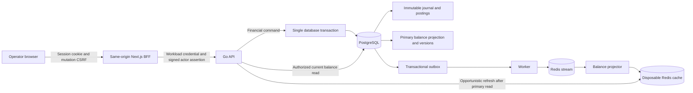

# Architecture and trust boundaries

LedgerSync is a closed-loop ledger service. It persists financial truth in
PostgreSQL. Current customer-visible balance reads return the authorized
PostgreSQL projection. Redis holds disposable cache, stream, and live-signal
data; it does not supply the returned financial balance.

See the [complete system design and user journey](architecture/ledgersync-system-design.md)
for sequence, component, data, recovery, and deployment diagrams, source
references, and the implementation action map.

## Non-negotiable boundaries

| Boundary | Rule |
|---|---|
| Browser to BFF | Browser accesses same-origin BFF routes only; session cookie is HttpOnly and mutations require CSRF. |
| BFF to API | BFF authenticates with its workload credential and adds a short-lived signed actor assertion. It never forwards browser credentials. |
| Financial commit | A posted transfer, two postings, balance versions, audit, idempotency outcome, outbox rows, and applicable webhook jobs commit or roll back together. |
| Current balance | `ReadCurrent` performs one tenant/owner-scoped PostgreSQL read. The service then checks the signed minimum version. An unsatisfied requirement returns temporary unavailability. |
| Cache | Redis is refreshed after a successful primary read and by asynchronous projection. A cache failure does not change the returned primary balance. |
| User access | Browser capabilities control discovery. BFF and API authorization remain authoritative. New transfers require the complete current authorized account picker. |
| Unknown outcome | Keep the original payload, key, and reference. Restore access or read stored evidence before exact retry. A blocked retry does not prove failure. |
| Funding approval | Production requires an activated finance policy and a finance approver different from the requester. Local single-operator review requires matching service and stored demo policy. |
| Reconciliation | Passed requires a matched run, zero mismatches, run ID, completion time, and ledger watermark. It describes an internal recorded snapshot, not bank settlement. |
| Delivery | Financial posting and event delivery are separate states. Retrying delivery does not reverse a posted transfer or authorize another posting. |
| Correction | Posted journal lines are immutable. Corrections are explicit compensating entries. |

Sources: [balance reader](../internal/application/accounts/balance.go),
[transfer transaction](../internal/platform/db/transfer_repository.go), and
[controlled financial commands](../migrations/000036_controlled_financial_commands.up.sql),
[funding policy checks](../internal/platform/db/funding_repository.go),
[browser capabilities](../web/src/features/console/capabilities.ts), and
[financial presentation rules](../web/src/lib/financial-ui.ts).

## Deployment and future scope

The [local Compose topology](../deploy/compose/docker-compose.yml) publishes
only the web workspace and optional collaboration peer on loopback ports. The
API, PostgreSQL, Redis, and worker use its internal network. The worker's current
network blocks normal external HTTPS egress.

The [Vercel adapter](../deploy/vercel/README.md) is a configured deployment
target. Its resource provisioning, database pool session affinity, durable
recovery evidence, and managed identity/key access need environment evidence.
The complete system design labels the AWS container topology as proposed.
Neither diagram proves a cloud deployment.

The current product does not include bank rails, cards, FX, or custody.
[Provider-led payouts](../specs/002-provider-led-payouts/plan.md) remain deferred;
the existing fake provider cannot move money. External movement requires a
separate approved provider program and operating decisions.
