# LedgerSync system design and user journey

**Review date:** 2026-10-10, Asia/Calcutta.

**Scope:** Current repository implementation, user experience, and deployment constraints.

**Product owner:** Vivek Painjane. **Delegated backup:** MasterVaik. The user confirmed delegated decision authority. Its exact scope, exclusions, expiry, and contact routes are not supplied. Specialist qualification and independent release approval are not inferred.

This document connects each user action to its system sequence and stored evidence. It describes the current closed-loop, same-currency ledger. It also records the separate cloud and provider designs. A diagram of a planned service is not evidence that the service is deployed.

## 1. Status and design boundary

| Label | Meaning in this document |
|---|---|
| Implemented | Source code or deployment configuration exists in this repository. This label does not claim that the current runtime passed a live check. |
| Configured target | A deployment adapter exists. Its credentials, provider resources, and runtime acceptance need separate evidence. |
| Proposed | A design or constraint for later work. It is not an implemented product capability. |
| Decision required | An accountable owner must select and record the operating policy or provider contract. |

The current product has a Next.js operator workspace and same-origin backend for frontend (BFF), a Go API, PostgreSQL, and background workers. Redis holds disposable projections, streams, and collaboration signals. PostgreSQL owns financial records, authorization records, command outcomes, audit, and durable delivery jobs.

The current balance reader returns a scoped PostgreSQL projection. It does not return a Redis balance. A successful primary read can refresh Redis. The summary in [architecture.md](../architecture.md) has been reconciled with this behavior. Source code is authoritative for this review: [balance reader](../../internal/application/accounts/balance.go).

Provider-led payouts are deferred in [the separate program](../plans/provider-led-payout-production-program.md) and [specification plan](../../specs/002-provider-led-payouts/plan.md). The [fake provider](../../internal/application/payouts/provider.go) cannot move money. No live external payout, provider settlement, or deployed AWS environment is inferred here.

## 2. User journey and screen responsibilities

The normal path is sign in, inspect the workspace, create an account if needed, record approved funding if needed, review a transfer, post it, and inspect the result. The follow-up path uses the saved request reference, journal, reconciliation, and delivery evidence.

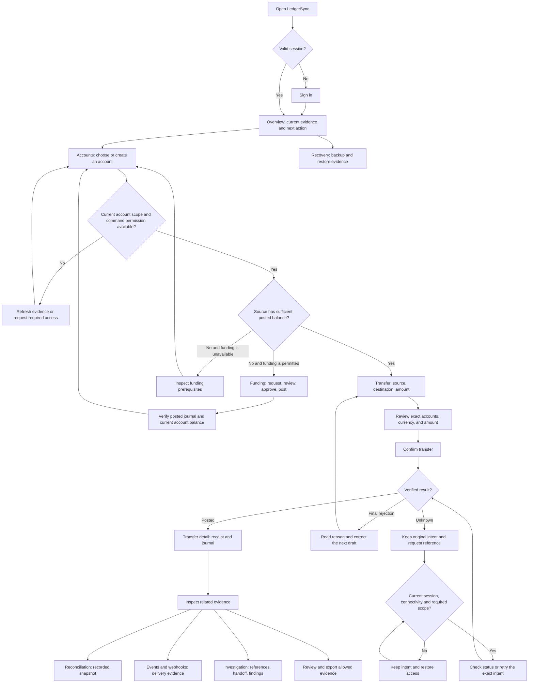

### Screen contract for the redesign

| Surface | Main user task | Primary action | Required visible evidence | Details shown on request |
|---|---|---|---|---|
| Overview | Identify the next useful task | One evidence-backed next action | Current data state and time | System explanation and onboarding step history |
| Accounts | Find and inspect an authorized account | Open account or create account | Name, reference, currency, status, posted balance | IDs, versions, ownership, transaction history |
| Funding | Record external value evidence | Request funding or review a selected request | Amount, destination, status, external evidence reference | Policy, requester, approver, journal, compensation |
| Approvals | Review a request within granted scopes | Open the record and make the permitted decision | Requester, exact effect, evidence, policy, and decision state | Decision history and related records |
| Corrections | Add a controlled compensating entry | Request, review, approve, and post a correction | Original record, reason, exact amount, and approval state | Immutable original journal and correction trail |
| Transfers | Review and post one internal movement | Review transfer, then confirm | Source, destination, exact amount, currency | Policy limits and technical references |
| Transfer detail | Determine the outcome and follow up | Open related evidence | Posted, rejected, or unconfirmed state; transfer/request reference | Journal, postings, balance versions, audit, delivery |
| Reconciliation | Compare ledger and stored balances | Review and run comparison when permitted | Status, scope, checked time, mismatch count | Watermark, schema/build versions, mismatch records |
| Events and webhooks | Confirm delivery and diagnose retries | Inspect an event or attempt | Delivery state independent of posting | Attempts, sanitized error, endpoint, replay controls |
| Investigations | Resolve a case and hand it over | Open evidence or handoff | Case state, referenced record, current evidence state | History, live-room findings, export bundle |
| Recovery | Inspect restore readiness | Inspect the latest verified evidence | Backup/restore date and result | Manifest, retention, digest result, run IDs |

Use short labels and one short status sentence. Keep financial outcome, error cause, and next safe action visible. Put definitions and implementation detail behind an accessible disclosure. A hidden description must not hide a material risk or an unresolved transfer outcome.

Use the same names, status colors, spacing, focus rules, and action order on all screens. Loading, empty, stale, partial, unavailable, forbidden, offline, and unknown-after-submit are distinct states. A failed read must not become an empty result. A delivery retry must not change a posted transfer to failed.

The onboarding service owns the step order and completion evidence. Opening a page does not complete a financial step. Manual confirmations and durable records remain distinct. Source: [guidance service](../../internal/application/guidance/service.go), [UI state contract](../product/ui-state-contract.md), and [onboarding contract](../product/onboarding-journey-contract.md). The onboarding contract retains old Phase 5 funding wording; the current service already reads posted funding journals.

The Guide's full operating path names funding request, approval, and journal posting separately. It then requires transfer-result inspection. Its follow-up section preserves the original uncertain intent, separates delivery from posting, and explains investigation handoff. Account balance timestamps use the shared UTC formatter, consistent with the workspace clock label.

### Capability and evidence gates in the current interface

The server-issued browser session controls navigation and action discovery. It does not grant authority by itself. Each BFF and API request rechecks identity and authorization. Local diagnostics and local guidance commands require the local environment and their scopes. Production administration is not released and remains unavailable.

New transfer preparation requires the complete authorized account picker within its current bounded page of 100 records. A partial page does not enable a command. Accounts must be active, distinct, and in the supported same currency. The new source must have a positive posted balance. The database rechecks permissions, available funds, status, currency, and policy when the command runs.

An unknown transfer keeps its exact payload, key, and reference. Connectivity and command scopes still apply. If the original accounts are no longer both in the active authorized picker, the interface blocks restoration and directs the operator to history. It keeps the original intent. That block does not prove that the transfer failed.

Overview totals use integer minor units and keep operating balances separate from customer funds. They do not sum different currencies into one value. A failed read is not an empty workspace. A reconciliation label needs the authoritative evidence defined in section 8.2.

Sources: [capabilities](../../web/src/features/console/capabilities.ts), [workspace stage](../../web/src/features/console/workspaceStage.ts), [transfer controller](../../web/src/features/transfers/TransfersController.tsx), [transfer form](../../web/src/features/transfers/TransferForm.tsx), and [financial presentation helpers](../../web/src/lib/financial-ui.ts).

## 3. System context and trust boundaries

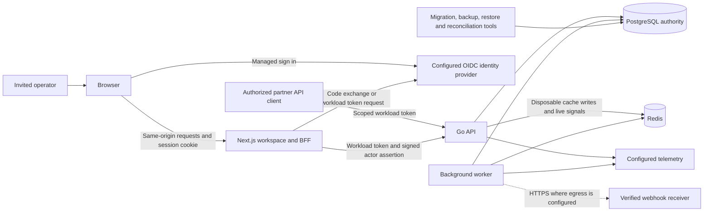

OIDC and external webhook nodes show supported integration boundaries. The local Compose stack uses an explicit local identity mode. It does not provision an OIDC server. The local worker network currently blocks normal external egress; see section 12.

| Boundary | Enforcement and user consequence |
|---|---|
| Browser to BFF | HttpOnly signed session, same-origin controls, CSRF for mutations, strict query/body bounds, no-store responses. An invalid session returns sign-in recovery. |
| BFF to API | Server-owned workload credential plus a short signed actor assertion. Browser-supplied tenant/subject values do not establish identity. |
| API to tenant data | Verified principal, route scope, database role/ownership checks, tenant-scoped reads, and command policy. Unauthorized records are not disclosed. |
| Financial command | Exact integer minor units, immutable journals, balanced postings, serialized policy checks, and durable idempotency outcomes. |
| Event dispatch | Committed outbox first; publication and delivery have their own persisted state. A retry can repeat delivery, not the financial posting. |
| Recovery evidence | The API reads a sanitized evidence index. It does not receive raw backup dumps. |

Sources: [BFF request context](../../web/src/lib/private-api.ts), [session](../../web/src/lib/session.ts), [security boundary](../../web/src/lib/security.ts), [actor verification](../../internal/platform/identity/bff_assertion.go), [shared replay guard](../../internal/platform/identity/postgres_replay_guard.go), and [database capability matrix](../security/database-capability-matrix.md).

## 4. Component architecture

The Go application is a modular service with separate API, worker, migration, and reconciliation binaries. Repository evidence does not require a new network service for each domain. Keep the financial transaction in one PostgreSQL authority.

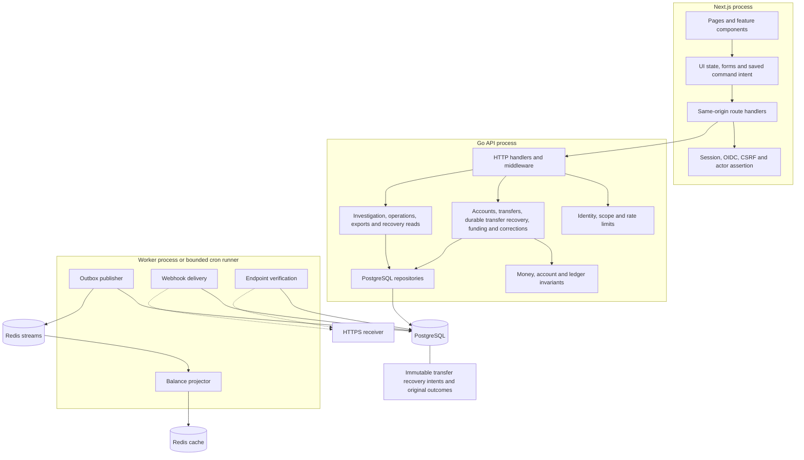

This diagram shows the functional boundaries. Some HTTP adapters use shared database types for classification or read wiring; it is not a claim that every package has strict dependency inversion.

Sources: [API wiring](../../cmd/api/main.go), [continuous worker](../../cmd/outbox-worker/main.go), [bounded worker runner](../../internal/bootstrap/worker.go), [application modules](../../internal/application), and [transport adapters](../../internal/transport/http/handlers).

## 5. Financial data model and invariants

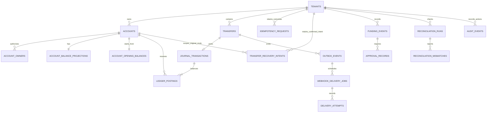

This is a relationship summary. It omits many columns, lifecycle tables, and exact foreign-key details. A transfer can be rejected without a journal. Funding and corrections also produce journals through their own source types. Delivery attempts reference their endpoint and outbox evidence; they do not repair a transfer.

The design must preserve these rules:

1. Store amounts as exact signed integers in minor units. JSON uses canonical decimal strings where required. Do not use floating point arithmetic for money.
2. A new customer account starts with zero balance and an opening baseline. Creating an account cannot create value.
3. An internal transfer has two equal postings in one currency. The transfer, journal, postings, balance versions, audit, idempotency outcome, outbox, and applicable webhook jobs commit together.
4. A rejected transfer creates no money movement. Some final rejections, including insufficient funds, have a durable result and audit record.
5. Posted journal lines are immutable. A correction or funding compensation has a separate approved command and journal.
6. Idempotency is scoped to tenant, actor, operation, and key. The same key with a changed fingerprint is a conflict.
7. A destination credit permission is not permission to inspect that account's balance. The public transfer response retains the allowed source evidence; private consistency metadata can cover an owned destination.
8. Reconciliation compares opening baselines plus immutable postings with PostgreSQL projections. Redis cannot repair financial truth.

Sources: [core schema](../../migrations/000002_transfer_ledger.up.sql), [funding schema](../../migrations/000018_controlled_funding_journals.up.sql), [journal semantic controls](../../migrations/000035_ledger_semantic_validation.up.sql), [controlled financial commands](../../migrations/000036_controlled_financial_commands.up.sql), [transfer response boundary](../../internal/transport/http/handlers/transfers.go), and [reconciliation repository](../../internal/platform/db/reconciliation_repository.go).

## 6. Authentication sequence

### 6.1 Managed OIDC flow: implemented, requires provider configuration

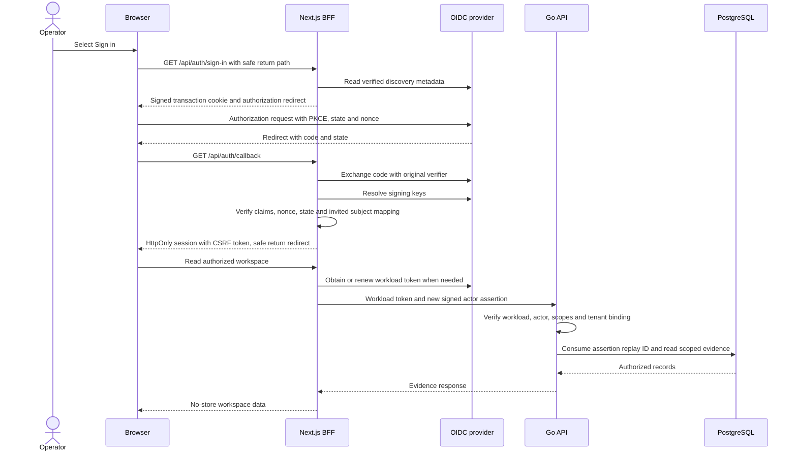

Sign-in success authenticates an invited operator. It does not approve funding, corrections, a cloud release, or a partner pilot. Sensitive commands also use their route scopes and stored authorization. Required step-up evidence comes from verified identity and a signed actor assertion.

Sources: [sign-in](../../web/src/app/api/auth/sign-in/route.ts), [callback](../../web/src/app/api/auth/callback/route.ts), [OIDC client](../../web/src/lib/oidc.ts), [workload credentials](../../web/src/lib/workload-credential.ts), and [actor verifier](../../internal/platform/identity/bff_assertion.go).

### 6.2 Local identity mode

Local sign in bypasses the provider only when the explicit local configuration permits it. The BFF creates a fixed local session. The API accepts its configured development workload credential and actor assertion. This mode belongs to the loopback local environment. Source: [local access](../../web/src/lib/local-access.ts) and [local Compose](../../deploy/compose/docker-compose.yml).

## 7. Account, funding, and transfer sequences

### 7.1 Create an account: implemented

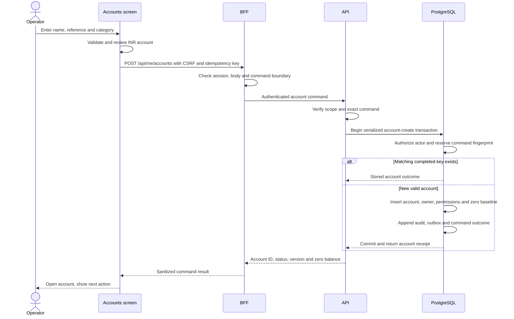

Metadata and status changes require the current account version. On a conflict, refresh the stored account before another review. Closing also verifies the authoritative zero state. Source: [account repository](../../internal/platform/db/account_command_repository.go), [account store](../../internal/platform/db/account_command_store.go), and [BFF account route](../../web/src/app/api/me/accounts/route.ts).

### 7.2 Record and post funding: implemented controlled workflow

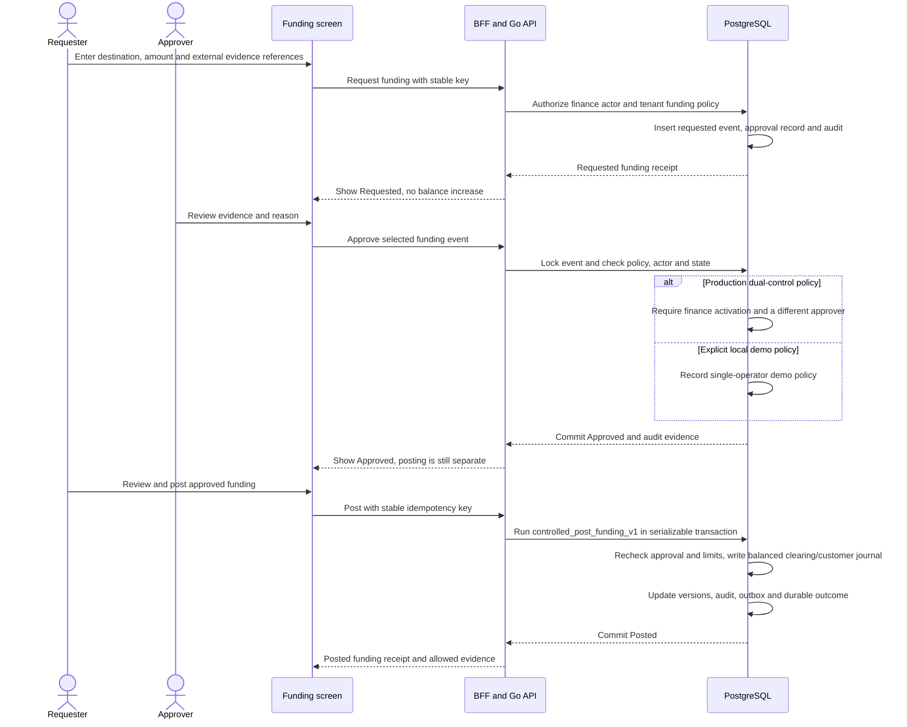

Funding records external value evidence. This workflow does not verify that a bank moved money. Financial and legal authorities must define acceptable external evidence before a real-money operating model. Approval and posting are different states. A rejected request does not increase a balance. Compensation is a new controlled event with its own approval and journal.

Reviewer independence is a stored policy rule. Production approval requires finance activation and a finance actor different from the requester. Local single-operator approval is permitted only when the service configuration and stored tenant policy both select that demo mode. The browser's local environment flag cannot create an exception. The recorded `demo_policy` flag is set at approval; its false value on an unreviewed request does not prove production approval. A local self-review is never independent production approval.

Before posting, the funding interface refreshes the selected event, requires Approved, and reviews the exact effect with the stored decision evidence. An unknown post keeps the original key and uses a refresh before exact retry. The funding reference check compares the expected value with its internal debit and credit journal totals. It does not reconcile an external bank or payment-provider feed.

Sources: [funding service](../../internal/application/funding/service.go), [funding repository](../../internal/platform/db/funding_repository.go), [controlled funding post](../../migrations/000036_controlled_financial_commands.up.sql), [funding views](../../web/src/features/funding/FundingViews.tsx), and [funding command](../../web/src/features/funding/useFundingCommand.ts).

### 7.3 Internal transfer with verified success: implemented

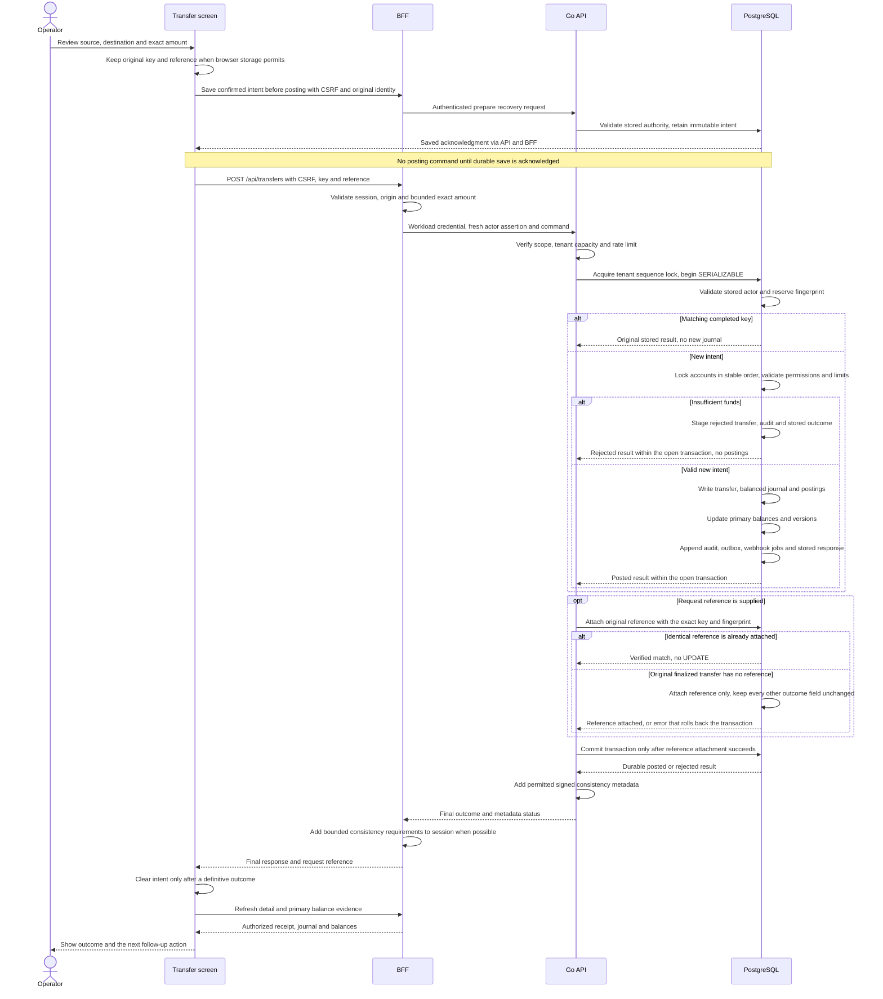

The application retries recognized serialization or deadlock errors within a bounded transaction loop. Reference attachment is part of that transaction. A failed attachment cannot follow a committed posted result. Its first attachment applies only to a finalized `transfers.create.v1` row with a null reference and every other row field unchanged. Clearing, rebinding, outcome changes, unfinished-row attachment, and other command kinds remain forbidden. An identical reference replay performs no update. A response timeout is a different problem and must follow the next sequence. Sources: [transfer repository](../../internal/platform/db/transfer_repository.go), [transaction sequencing](../../internal/platform/db/postgres.go), [controlled transfer SQL](../../migrations/000036_controlled_financial_commands.up.sql), [reference and legacy convergence](../../migrations/000037_live_investigation_rooms.up.sql), [additive reference repair](../../migrations/000039_transfer_request_reference_repair.up.sql), [transfer BFF](../../web/src/app/api/transfers/route.ts), and [saved intent hook](../../web/src/features/transfers/useTransferSubmission.ts).

### 7.4 Unknown transfer result and follow-up: implemented safety rule

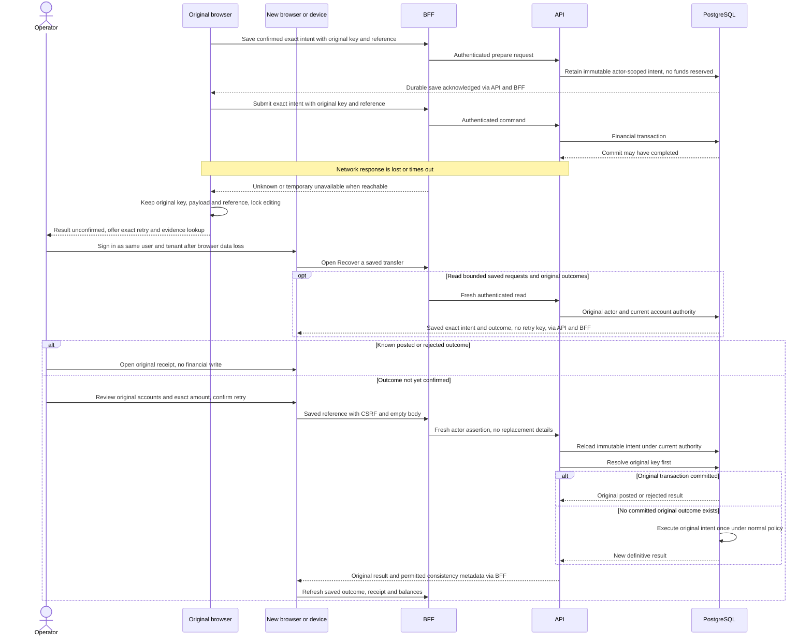

Do not create a new key to bypass an unconfirmed request. A missing status result is not proof that the original request did not commit. A repeat delivery request needs a new actor assertion, but the financial idempotency key and payload remain the same.

Confirmed UI transfers save the immutable request in PostgreSQL before sending the financial command. `sessionStorage` is an optional same-tab convenience. Loss of all browser data does not remove server intent. Sign in with the same stable subject and tenant, then open **Recover a saved transfer** on Transfers. The list is paginated at 25 records and includes unresolved and known final outcomes. Opening a known receipt sends no financial write. An unresolved request requires explicit review and confirmation; it may complete the original transfer if no outcome exists.

Private API routes are `POST /api/transfers/recovery` (prepare), `GET /api/transfers/recovery` (bounded list), and `POST /api/transfers/recovery/{requestReference}/retry` (original retry). The BFF retry route omits the final `/retry` segment. Retry accepts an empty body and reconstructs the command from server records. No list exposes an idempotency key. Reads use authenticated tenant and original actor plus current account permissions. Write scope and stored operator/finance authority are required for posting. Inactive accounts and incomplete account pickers do not prevent outcome discovery. Revoked account authority hides the request. A reference grants no permission.

The saved intent does not reserve funds, approve a later policy exception, or schedule an automatic retry. Accounts, amount, reference, key, and fingerprint cannot be edited or deleted. Concurrent original commands and recovered retries resolve the same financial key. A final insufficient-funds rejection is retained and replayed. A policy or authorization denial without a final idempotency outcome remains unresolved. An empty page is not proof of failure for legacy clients whose request predates durable preparation. Use transfer history and exact-reference investigation for those records. Sources: [recovery schema](../../migrations/000040_transfer_recovery_intents.up.sql), [recovery repository](../../internal/platform/db/transfer_recovery_repository.go), [recovery handler](../../internal/transport/http/handlers/transfer_recovery.go), and [recovery UI](../../web/src/features/transfers/TransferRecovery.tsx).

The transfer list and selected record show financial posting and delivery as separate states. A Posted transfer with Retrying delivery remains Posted. Delivery follow-up uses event and attempt evidence; it must not create another financial transfer. Source: [transfer views](../../web/src/features/transfers/TransferViews.tsx).

The BFF preserves a confirmed commit when optional response metadata fails. When the response body cannot be read after upstream success, it can return a committed receipt with unavailable metadata and the original retry instruction. The current transfer hook may still show an unconfirmed state until replay recovers a full transfer receipt. The interface must not claim no money moved in that case. Sources: [committed response](../../web/src/lib/committed-response.ts), [BFF](../../web/src/app/api/transfers/route.ts), [intent hook](../../web/src/features/transfers/useTransferSubmission.ts), and [recovery runbook](../runbooks/committed-response-recovery.md).

### 7.5 Read after a committed write: current primary-read design

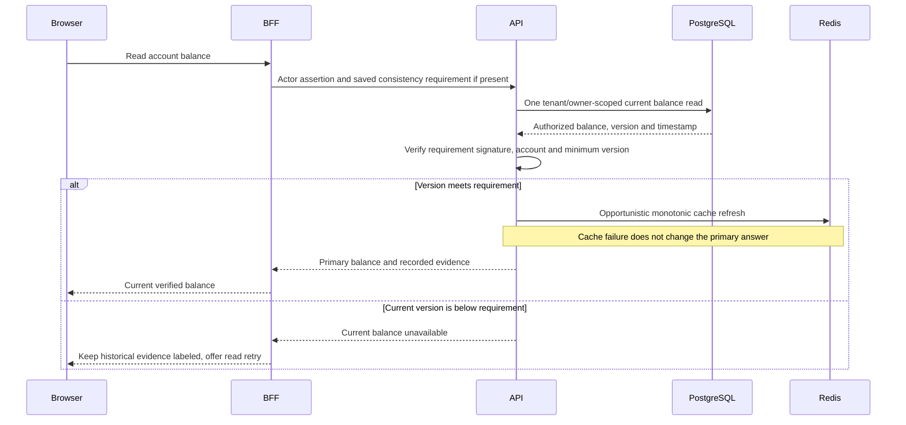

Authorization precedes consistency-token inspection to preserve the non-disclosure boundary. Do not remove PostgreSQL checks for a faster cache answer without a separate reviewed design. Source: [balance reader](../../internal/application/accounts/balance.go), [balance repository](../../internal/platform/db/balance_repository.go), and [balance BFF](../../web/src/app/api/accounts/[accountId]/balance/route.ts).

## 8. Asynchronous delivery and reconciliation

### 8.1 Outbox, cache projection, and webhook delivery: implemented processors

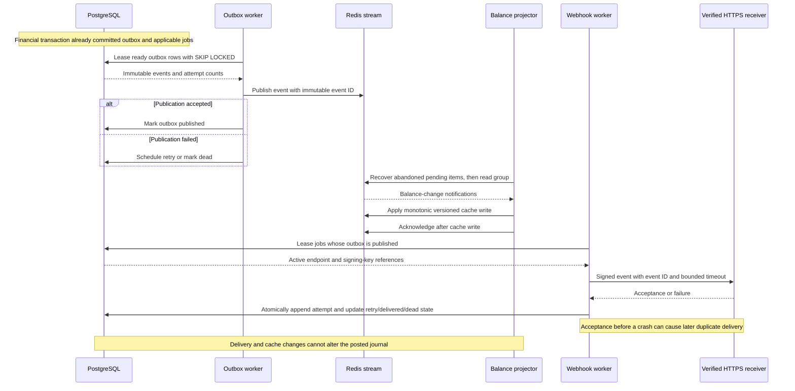

Publication is at least once. A crash after Redis accepts an event but before PostgreSQL records publication can repeat it. Consumers use immutable IDs and monotonic versions. Webhook receivers must deduplicate by event ID. A delivery replay appends recovery evidence and retains the original payload. Endpoint verification uses separate durable jobs before activation.

A webhook is currently gated on outbox publication. Redis publication failure can therefore delay an external notification even while the financial record and primary balance are valid. This coupling is implemented; whether a future webhook should dispatch directly from PostgreSQL jobs is a separate reliability decision.

Sources: [outbox worker](../../internal/application/outbox/worker.go), [outbox leases](../../internal/platform/db/outbox_repository.go), [projection](../../internal/application/projection/balance_projector.go), [webhook worker](../../internal/application/webhookdelivery/worker.go), [delivery store](../../internal/platform/db/webhook_delivery_job_repository.go), [endpoint verification](../../internal/application/webhookverification/worker.go), and [secure dispatcher](../../internal/application/webhookdelivery/dispatcher.go).

### 8.2 Reconciliation: implemented comparison, no automatic repair

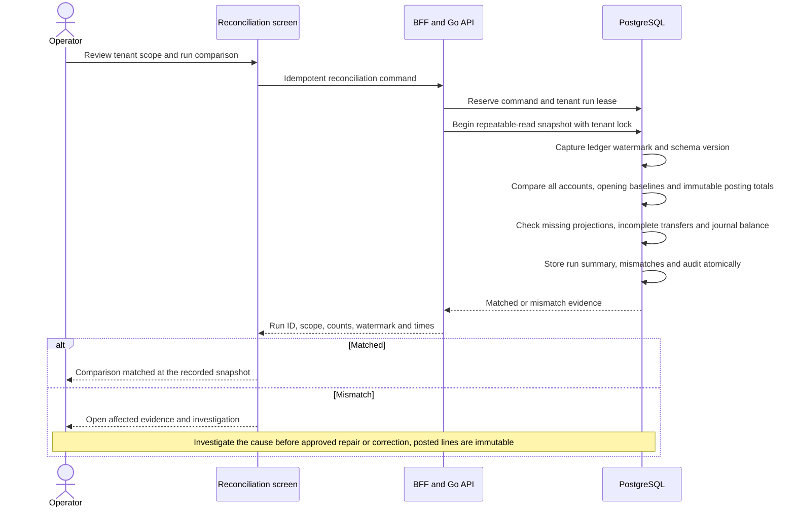

An empty tenant scope is a mismatch, not a successful zero-account comparison. A matched result describes its recorded snapshot. It is not a claim that every later transfer or external bank settlement is correct. The interface shows Passed only when the run has Matched status, zero mismatches, a run ID, a completion time, and a ledger watermark. An incomplete matched record is Result not verified. An operator cannot mark a mismatch resolved by changing its display state; a later authoritative run must provide the comparison evidence.

Sources: [reconciliation command](../../internal/platform/db/reconciliation_command_repository.go), [comparison](../../internal/platform/db/reconciliation_repository.go), [financial presentation helper](../../web/src/lib/financial-ui.ts), and [reconciliation views](../../web/src/features/reconciliation/ReconciliationViews.tsx).

## 9. Investigation and handoff

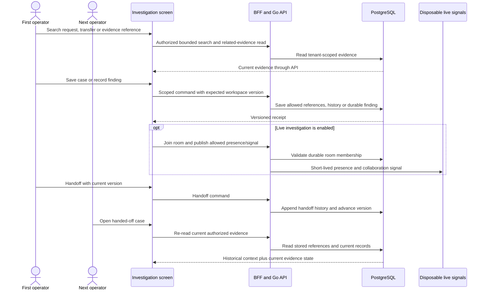

Saved references and findings are durable. Live presence is not a financial approval or a durable finding. On a version conflict, refresh the case. A historical case reference does not grant permission to read a record after access changes.

Sources: [workspaces](../../internal/application/investigation/workspaces.go), [live rooms](../../internal/application/investigation/live_rooms.go), [signal transport](../../internal/platform/events/live_investigation_signals.go), and [investigation read adapter](../../internal/transport/http/handlers/investigation.go).

## 10. Recovery and retention

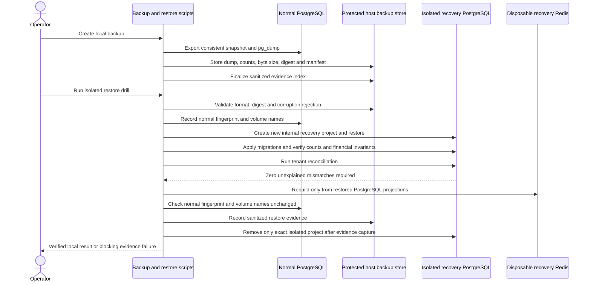

Local backup data remains outside Git. The API receives only the sanitized index through a read-only mount. A local logical restore drill does not prove managed WAL archiving, provider isolation, a production recovery point, or production RPO/RTO.

Recovery labels a schema-different backup as historical. It requires a passing restore drill to name the exact latest backup and finish after that backup was finalized. A failed refresh or offline state cannot retain a current-proof label. Even a matching successful drill proves only the listed backup snapshot; it does not prove that later writes are covered. No owner-defined age limit or production recovery target is inferred from these records.

Retention tools must preserve legal holds and policy constraints. Idempotency retention defines the window in which an original key can be resolved safely. Do not advertise indefinite replay or let the interface silently convert an old unresolved command into a new movement after outcome retention ends.

Sources: [restore runbook](../runbooks/restore.md), [backup script](../../scripts/backup-local.ps1), [restore drill](../../scripts/local-restore-drill.ps1), [recovery Compose](../../deploy/compose/docker-compose.restore.yml), [manifest index](../../internal/platform/recovery/manifest_index.go), [PITR requirement](../runbooks/backup-pitr.md), and [retention rules](../runbooks/data-retention.md).

## 11. Local deployment: actual repository topology

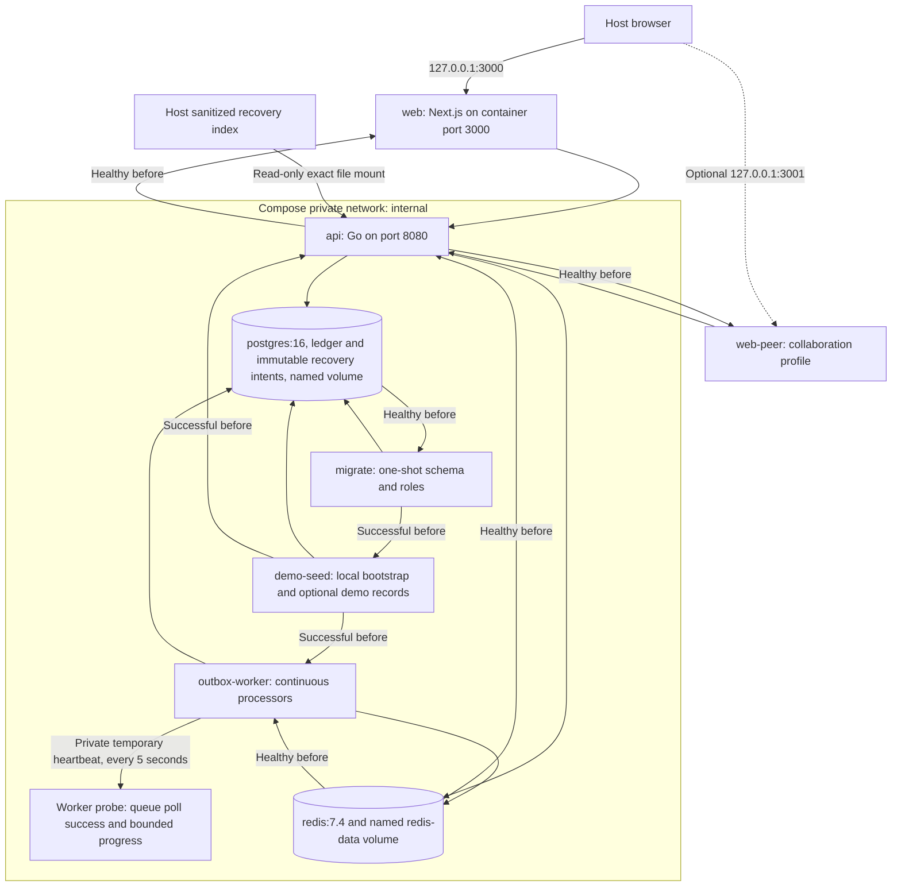

Only web and the optional peer publish host ports. API, database, and Redis stay on the internal network. Web also joins the edge network. The worker joins only the internal network. The immutable recovery-intent table shares PostgreSQL and its protected backups. This change adds no service, Redis recovery key, or public API port. Named volumes persist ordinary stop and restart. Data reset is a separate operation.

The root [docker-compose.yml](../../docker-compose.yml) delegates to [the canonical topology](../../deploy/compose/docker-compose.yml). [start-local.ps1](../../scripts/start-local.ps1) prepares local secrets and startup inputs. Empty initialization is the default; demo records require the explicit demo mode.

The API readiness wiring checks PostgreSQL. Startup also requires Redis for the configured application routes. The worker waits for schema, roles, and local bootstrap before startup. Its `--healthcheck` command reads a private temporary snapshot from the existing progress monitor. All four queues must have completed a successful poll. The latest poll must not have failed, progress age must be at most 60 seconds, and the monitor heartbeat must be at most 15 seconds old. Idle successful queues pass. A live process with failed polls or a stalled queue fails. The probe publishes no port and requires no broader database grant. Docker health and `status-local.ps1` consume the result. Individual persisted delivery retries remain separate from worker poll failure and financial posting. Managed alert routing remains a deployment acceptance requirement.

## 12. Deployment targets and constraints

### 12.1 Vercel: configured target, deployment not established by this review

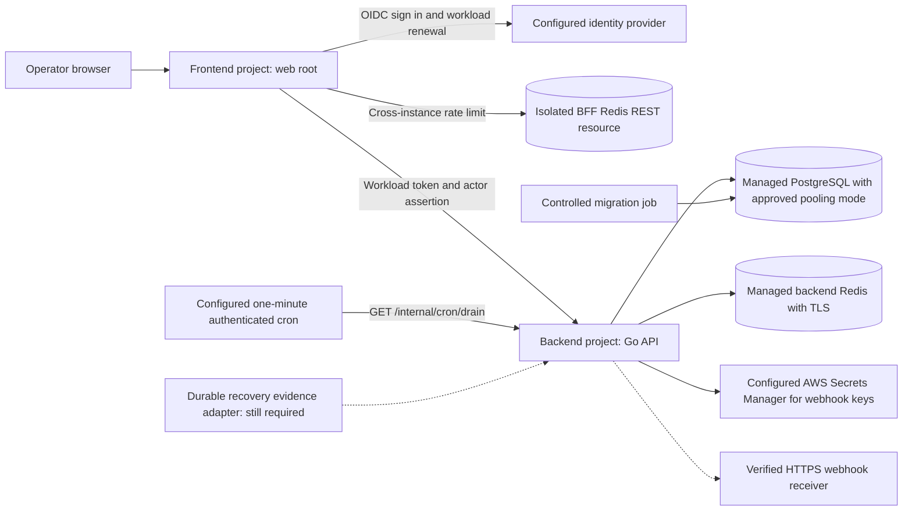

This target exists in [root configuration](../../vercel.json), [web configuration](../../web/vercel.json), [deployment instructions](../../deploy/vercel/README.md), and [bounded cron handler](../../internal/transport/http/handlers/cron_drain.go). It uses a request-driven drain with a bounded runtime. A one-minute trigger is not a 200 ms delivery guarantee.

Preview and Production must use isolated database, Redis, limiter namespaces, identity credentials, and backend URLs. Migrations run from a controlled release job. They do not run in a build or application cold start.

Review these constraints before acceptance:

1. `WithSerializableSequence` takes a session advisory lock before `BEGIN` and releases it after the transaction. A transaction-mode pooler does not automatically preserve that server-session affinity. Select and prove a compatible session/direct connection mode, or redesign sequencing in a separate reviewed change.
2. The continuous worker now uses `redisconn.Options`, as the API does. Both parse local addresses and managed `redis://` or `rediss://` URLs. Provider connectivity and TLS acceptance still need live environment evidence.
3. The non-development worker resolves webhook signing keys through AWS Secrets Manager. A Vercel target needs an approved AWS credential and key policy or a separately implemented provider-neutral resolver. Environment variable names do not establish that access.
4. The filesystem recovery-evidence root is not durable on request-driven infrastructure. Use an encrypted durable store or database-backed adapter before those routes can support cloud recovery claims.
5. Process liveness, route readiness, queue progress, delivery latency, and recovery readiness require separate evidence.

Sources: [transaction sequence](../../internal/platform/db/postgres.go), [Redis options](../../internal/platform/redisconn/options.go), [worker](../../cmd/outbox-worker/main.go), [AWS key resolver](../../internal/platform/secrets/aws_secrets_manager.go), and [Vercel operating limits recorded in the repository](../../deploy/vercel/README.md). This review does not verify current provider plan limits or live project state.

### 12.2 AWS container deployment: proposed target

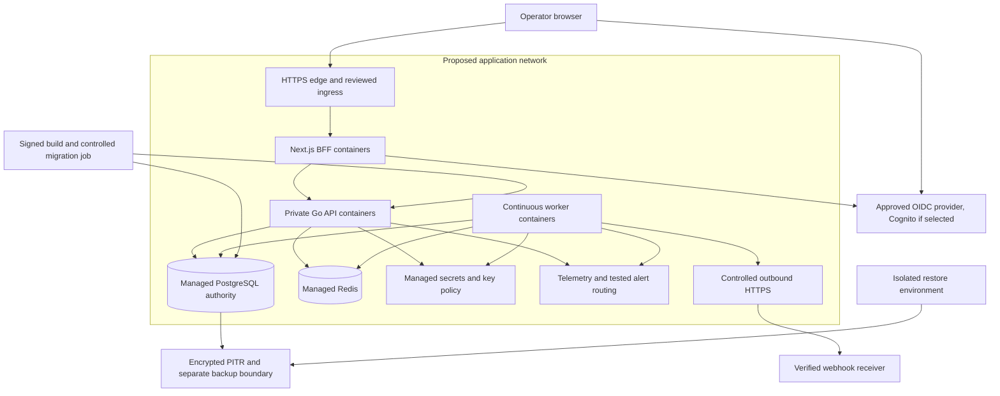

This is a design target, not an existing Terraform deployment. It follows the repository's managed-environment plans and recovery requirements. Region, account, service placement, high availability, DNS, resource size, egress policy, and cost ceiling remain decisions. Keep application and backup credentials in separate reviewed trust boundaries.

Source: [master completion plan](../plans/ledgersync-master-product-system-and-website-completion-plan.md), [production program](../plans/provider-led-payout-production-program.md), and [PITR policy](../../deploy/backup/postgres-pitr-policy.yaml).

### 12.3 Proposed release sequence

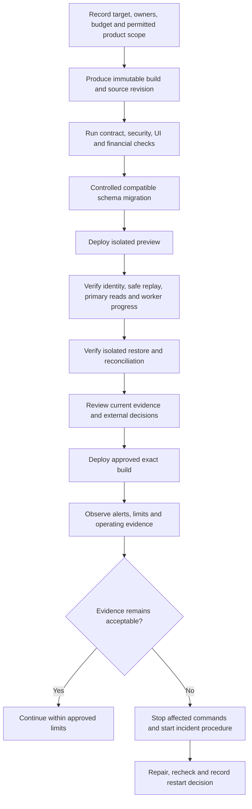

An application rollback cannot undo posted journals. Use compatible schema changes and controlled compensating commands where a financial correction is needed. Cloud release and partner activation are separate owner decisions.

## 13. Deferred provider payout sequence: proposed only

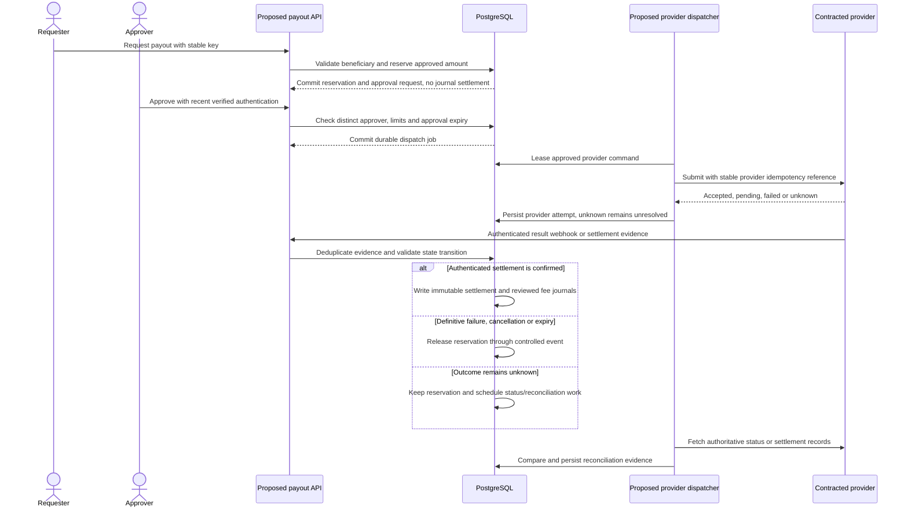

No provider HTTP request occurs inside a financial transaction. A provider acceptance is not settlement. Unknown status does not justify a second money-moving request with a new reference. The future payout domain must use its own IDs, reservation rules, approval rules, and settlement states.

The current repository does not provide this end-to-end flow. Its fake provider returns pending, rejects external webhooks, and returns no settlement records. Provider contract, supported jurisdiction, clearing/fee accounting, retention, operating limits, and incident ownership are required before this program resumes. Source: [deferred payout specification](../../specs/002-provider-led-payouts/spec.md), [payout plan](../../specs/002-provider-led-payouts/plan.md), and [fake provider](../../internal/application/payouts/provider.go).

## 14. Gap analysis and action map

| ID | Evidence and gap | Action | Current disposition | Acceptance evidence |
|---|---|---|---|---|
| SD-01 | The former architecture summary and older onboarding text described historical balance/funding behavior. | Use this document as the current map. Keep older guides and ADRs consistent with their stated historical scope. | Architecture summary, Overview, and guide aligned with the current journey in this change. | Source review and the [UI verification record](../design/ui-system-alignment.md) trace the current account, funding, transfer, and follow-up steps. |
| SD-02 | Long descriptions repeated technical explanations across UI states. | Use short status/action text and accessible details. Preserve outcome, reason, reference, and safe recovery action. | Current UI redesign complete; automated and visual review passed. Human task-time, physical-device, Safari, and assistive-technology review remain open. | Desktop/mobile, keyboard, contrast, and financial-state checks are recorded in the [UI verification record](../design/ui-system-alignment.md). |
| SD-03 | Standalone worker previously treated managed URLs as raw addresses, unlike the API. | Reuse the existing `redisconn.Options` parser. | Implemented in `cmd/outbox-worker/main.go` in this change. | Focused package tests cover local host:port and managed TLS options; binary package compiles. |
| SD-04 | Session advisory lock spans `BEGIN`/`COMMIT`; configured cloud target requests pooled PostgreSQL. | Record pooler mode and prove session affinity. Use direct/session mode or separately redesign sequencing. | Deployment constraint; no transaction behavior changed. | Concurrent same-tenant financial tests pass against the exact provider connection mode; locks release on failure. |
| SD-05 | Local worker joins only the internal network. External HTTPS delivery and verification cannot use normal egress. | Select local no-egress behavior or a reviewed controlled egress/test-receiver profile. | Explicit local constraint; network has not been widened. | Chosen topology proves allowed delivery and rejection of disallowed destinations. |
| SD-06 | The old process-only worker probe could pass despite failed polls after provisioning. | Use queue completion/failure and bounded progress evidence. Wait for local bootstrap. Consume the probe through Docker health and the status script. | Local readiness implementation complete. The original connection-failure cause is not proven; managed alert routing is still a target acceptance task. | Focused tests cover unstarted, idle successful, failed, recovered, stale-heartbeat, malformed, and stalled states. The current runtime verification is recorded in the walk-through report. |
| SD-07 | Webhook job claim requires outbox publication, which depends on Redis. | Decide whether notification delivery must remain coupled to stream publication. | Implemented coupling is documented; decision required for cloud reliability targets. | Redis-loss test matches the approved notification delay and recovery contract. |
| SD-08 | A process with primary-read balances still requires Redis during startup. | Decide the permitted degraded-start policy and separate route readiness from financial-data readiness. | Follow-up design decision; startup behavior unchanged. | Exact routes available during Redis outage match the chosen policy and identity/limiter dependencies. |
| SD-09 | Vercel filesystem cannot retain the current recovery evidence root durably. | Implement a durable encrypted evidence adapter and retention/access contract before cloud recovery acceptance. | Cloud recovery gap. | Cold start, multi-instance read, retention, digest validation, and isolated restore prove persistence. |
| SD-10 | Non-development webhook keys use AWS Secrets Manager even in the Vercel target. | Record approved cross-provider identity/key access or implement a reviewed alternative resolver. | Provider integration decision. | Rotation, revocation, least privilege, and key-fetch failure behave as specified. |
| SD-11 | Browser data loss previously removed the original retry identity. | Save immutable confirmed intent before posting. List the original actor and tenant with current account authority. Retry reconstructs the original server command. | Implemented with migration 000040 and explicit recovery review. Legacy unsaved requests still need history/reference investigation. | Separate clean browser contexts, lost requests/responses, concurrent retry, frozen accounts, denied access, and balanced original journals. |
| SD-12 | Optional committed-response metadata can be unavailable while the financial commit is confirmed. | Represent commit knowledge separately from receipt completeness; recover the original receipt with exact replay. | Current presentation keeps posting, receipt freshness, delivery, and unknown outcome separate; focused browser checks passed. | Metadata/body failure after commit never shows confirmed no-movement or creates a new key. |
| SD-13 | AWS diagrams and PITR policy describe requirements; provisioning and managed recovery evidence are absent from this review. | Select target and owners, then create reviewed infrastructure and provider acceptance evidence. | Proposed deployment; no cloud success claimed. | Exact-build identity, boundary, alert, backup and restore evidence with accountable owners. |
| SD-14 | External payout program is deferred; only fake provider interface exists. | Keep live payout actions out of current product claims. Resume through the separate provider-neutral program only after scope decision. | Deferred. | Approved adapter, durable reservation/dispatch, authenticated settlement and reconciliation; external sign-offs. |
| SD-15 | Diagrams can drift after code changes. | Update the affected sequence and source links in the same change as a command, identity, worker or deployment boundary. | Maintenance rule for this map. | Reviewers can trace the changed journey to a current implementation and meaningful test. |
| SD-16 | The preserved local database records live-room changes under old 000034/000035 names. Current 000037 initially failed on the existing reference column. | Accept only the reviewed legacy schema and history pair; retain records and old versions; install and validate current missing controls through the migration runner. | Guarded convergence added to 000037 and applied locally through the canonical runner. Unknown structures stop without a manual applied marker. | Fresh and seeded legacy upgrade, unchanged room/finding/operation/history snapshots, eleven incompatible metadata/data cases, and four same-name index collisions passed isolated tests. Local 37/38 migration and read smoke passed. |
| SD-17 | The reference attachment function attempted an UPDATE after finalization, while the existing trigger rejected every finalized outcome UPDATE. This caused referenced transfer commands to roll back. | Permit first reference-only attachment on finalized transfer rows; make exact replay return without UPDATE; preserve all financial fields and prior transition rules. Restore the prior guard before an isolated down migration drops the column. | Narrow correction added to 000037. Additive 000039 also repairs already-recorded original current 000037/000038. Financial sequencing and advisory locks are unchanged. | Referenced transfer posts and exact replay add one journal/two postings on fresh, known legacy, and already-recorded original current 37/38 paths. Outcome edits, rebinding, other operations, unfinished-row attachment, and combined finalization are rejected. Isolated rollback restores the strict guard. |
| SD-18 | Recovery combined current database reachability with an older backup/restore into an unqualified complete label. It did not require the drill to name the latest backup. | Mark schema-different proof as historical; require exact backup identity and later drill time; warn that subsequent writes are outside the proof. | Implemented in the recovery posture helper and UI. An owner-defined backup age policy remains a separate operating decision. | Browser regressions cover historical schema, wrong backup identity, exact matching proof, and failed refresh. |
| SD-19 | The Guide omitted the separate funding posting step and record follow-up. Account balance details used local time under a UTC workspace label. | Add explicit posting and result verification steps, follow-up links, and shared UTC timestamps. | Implemented in the Guide and account balance view; journey diagram aligned. | Guide order and an Asia/Kolkata browser timestamp check cover the changed path. |

The legacy convergence is deliberately narrow. It compares the reviewed PostgreSQL 16 catalog definitions and permitted metadata against a [credential-free fixture](../../tests/integration/testdata/legacy-live-investigation.sql). Extra columns, changed keys/checks/indexes, generated identities, altered collations, RLS, inheritance, and a disabled or changed immutable-finding trigger stop adoption. Historical lifecycle violations stop validation; rows are not repaired silently. The [migration regression suite](../../tests/integration/live_room_migration_compatibility_test.go) creates separate test databases and preserves the configured runtime authority. Legacy invite expiry is capped to the room expiry in the [repository](../../internal/platform/db/live_investigation_repository.go); its stronger retained expiry constraint is preserved.

The [additive 000039 repair](../../migrations/000039_transfer_request_reference_repair.up.sql) accepts only the reviewed original or corrected function bodies and compatible column, trigger, function, and owner metadata. It preserves existing function owners. The [provisioning contract](../../deploy/postgres/roles.sql) assigns the controlled attachment helper to the NOLOGIN `ledgersync_migration_owner`, grants its existing required object permissions, and gives the API execute permission before startup. The trigger helper remains owned by the idempotency table owner. No API membership in the migration-owner role or broader table grant is introduced. The [original current 000037 fixture](../../tests/integration/testdata/original-current-live-investigation-37.sql) proves that an already-recorded target receives 000039 through `ApplyPending` without rewriting prior history. The [000039 down file](../../migrations/000039_transfer_request_reference_repair.down.sql) keeps the safety repair; it does not restore the defective helper. Deeper 000037 rollback removes live-room data and restores the pre-reference guard before removing the reference column. Those down paths were used only in isolated tests.

### Implementation order

1. Current scope completed: UI simplification, current system map, worker URL alignment, and local migration/restart checks. Keep the recorded financial recovery rules.
2. Review the current diff with product and finance owners. Complete human task review and physical-device, Safari, and assistive-technology checks when those targets are selected.
3. Inventory each release target's migration history and definitions. Apply the reviewed 000039 repair through the migration runner. Unknown structures require their own reviewed migration and upgrade evidence.
4. Select the deployment target, connection pooling mode, egress policy, worker latency, identity, and evidence store.
5. Implement the chosen reliability and cloud adapters with targeted fault checks.
6. Obtain managed recovery and operating evidence before shared activation.
7. Reopen the provider program only through its separate scope and evidence gates.

## 15. Open operating decisions

| Decision | Required owner or evidence |
|---|---|
| First partner, first workflow, pilot measures and limits | Product owner and partner evidence |
| Finance policy, accepted funding evidence, correction rules and wording | Named finance owner and approved accounting policy |
| Target environment, budget, region, connection mode and egress | Platform/billing owner and reviewed configuration |
| Identity provider, invitations, role mapping and emergency revocation | Security/platform owner and live identity evidence |
| RPO/RTO, backup retention, restore cadence and legal holds | Operations, finance and applicable legal/privacy owners |
| Alert routes, support hours, stop/restart authority and incident contacts | Operations owner and tested contact route |
| Provider-led payout scope and liability | Product, contracted provider, finance and legal decision |

Vivek Painjane is the confirmed owner. The user confirmed that MasterVaik has delegated decision authority. Record its exact scope, exclusions, expiry, and contact routes. Finance qualification, independent release approval, and on-call availability are not inferred.

## 16. Verification record and limits

This document is based on current source reads, repository configuration, and existing contracts. The code graph supported discovery, but its index omitted newer files; source on disk was checked for the conclusions above.

The worker change uses an existing tested configuration parser. `go test ./internal/platform/db ./internal/platform/redisconn ./cmd/outbox-worker` passed for this change on 2026-10-10. The worker package compiled; it has no package-local test files. The parser tests cover local addressing, managed credentials/database selection, TLS, and empty configuration. No new test duplicates the parser implementation.

The [UI verification record](../design/ui-system-alignment.md) records 206 frontend unit checks, 148 Chromium browser checks with no retries, whole-web lint, production builds, and nine reviewed previews. Browser checks use explicit API fixtures; they do not prove a live financial posting. Physical-device, Safari, assistive-technology, and measured user task-time evidence are not part of this result.

The [migration regression suite](../../tests/integration/live_room_migration_compatibility_test.go) passed all seven focused test groups on isolated PostgreSQL 16 databases. It proves clean migration, adoption of the seeded known legacy fixture without changing its room/finding/operation/history snapshots, referenced transfer posting and exact replay, isolated downgrade, four index-name collision failures, and eleven incompatible schema/data failures. The seventh group applies the exact original current 000037 and real 000038 first, retains populated financial/idempotency/live rows, reproduces the specific immutable-guard failure, and then applies 000039. Every prior migration row/timestamp, helper owner/ACL, table ACL, and API role boundary is unchanged. One 000039 row is added. Referenced posting and replay then add exactly one journal and two postings. An unexpected STRICT-helper variant stops without recording 000039. First-reference tests preserve all other outcome fields and require trigger SQLSTATE `55000` for forbidden mutations. This execution used a host-built Linux test binary with `-test.run '^TestLiveRoomMigration'`; each case creates and removes a separate test database. The configured runtime database is not seeded or truncated.

On 2026-10-10, the local Compose migration and role/login provisioning completed through current 000039. Its history contains 41 rows: the current 39 source migrations and the two preserved legacy names from 2026-09-08. All prior migration rows/timestamps remain unchanged across 000039. Three required legacy checks are validated. The attach function is owned by `ledgersync_migration_owner`; the API has execute permission and PUBLIC does not. The API, worker, PostgreSQL, Redis, main frontend, and optional peer frontend are healthy. The canonical login, session, authorized account read, and reconciliation read smoke passed on loopback ports 3000 and 3001. This read smoke does not establish a complete cross-instance live-room call.

Across the final 000037 through 000039 migrations and restart, the local database retained six accounts, four transfers, ten postings, and identical balance/transfer/posting fingerprints. The API and worker environment hashes, process identity, private network, read-only filesystem, capability restrictions, and security options are unchanged. The existing PostgreSQL/Redis named volumes and the newest frontend image IDs are preserved. The isolated test databases were removed. These local runtime checks are read-only; financial writes used separate test databases.

The existing worker logged `42P01` missing-relation poll errors after provisioning while its former Compose process probe remained healthy. The worker group and workload login had the required schema USAGE and table SELECT/UPDATE grants. A worker-only restart refreshed its connections without changing credentials, grants, image, or configuration. No errors were logged after that restart. `pg_stat_activity` then showed a recent successful verification-job query in the correct runtime database; pending and dead outbox counts were both zero. Main/peer smoke and all financial/configuration fingerprints passed again. This records the initial recovery, not a cache root cause, non-empty event latency, or production readiness. SD-06 now records the subsequent local probe and startup-order repair.

The initial container Go build failed during dependency-download TLS negotiation. The follow-up repair reproduced that failure in a fresh pinned Go container, then proved that `GODEBUG=tlsmlkem=0` permits the same download. Local Compose now supplies this setting through a builder-only argument. Direct Dockerfile builds retain the Go default. A canonical no-cache build passed for API, migration tool, and worker without the temporary recovery override. HTTPS certificate and module checksum checks remain enabled. See the [TLS and journey verification record](../design/journey-verification-20261010.md) and [runtime runbook](../runbooks/local-runtime-smoke.md).

`ApplyPending` skips filenames already in migration history. The revised 000037 covers a fresh database and the known legacy database; additive 000039 covers the reviewed already-recorded original current 000037/000038. Each path has isolated execution evidence. The strict preflights stop on unknown definitions; this result does not qualify every historical schema.

The source review checked capability gates, funding review policy, exact-intent retry, reconciliation evidence, and separate posting/delivery states. The follow-up parsed and rendered all 19 Mermaid blocks with Mermaid 12.1.0. It repaired sequence-message punctuation and used intrinsic SVG dimensions. Every diagram passed a rendered text-bound check. The [gallery](diagrams/index.html) provides SVG, PNG, and Mermaid sources; its [manifest](diagrams/manifest.json) binds each output to the source hash and line. Prior money-command evidence is recorded in the [follow-up report](../design/journey-verification-20261010.md). Current screen, worker fault, and current-schema recovery evidence is in the [user walk-through](../design/user-journey-walkthrough-20261010.md). This document does not claim a cloud deployment, provider certification, production recovery result, independent finance/release approval, or measured improvement in user task time.
