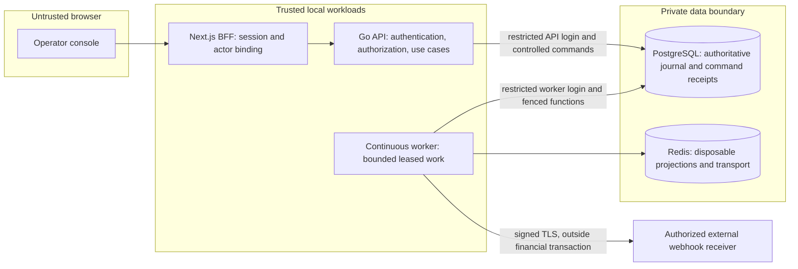

# Architecture and important sequences

The [module map](module-map.md) names the owners. [ADR 001](../architecture/decisions/001-portfolio-module-boundaries.md) explains why these are modules in one application. The process split does not create a distributed financial database.



The BFF derives authority from an opaque session. The API authenticates a workload and, where required, a delegated actor. Scoped database transactions set tenant and actor context. Forced row policies protect against missing query filters. Controlled functions restrict financial writes. These settings do not isolate tenants from a fully compromised shared workload. See the [capability matrix](../security/database-capability-matrix.md).

## Normal transfer

```mermaid
sequenceDiagram
  participant UI as Browser
  participant BFF as BFF
  participant API as Transfer handler/service
  participant PG as PostgreSQL
  UI->>BFF: Prepare recovery identity with stable reference, key and full intent
  BFF->>API: Authenticated preparation
  API->>PG: Store durable preparation
  UI->>BFF: POST transfer with original reference, key and body
  BFF->>API: Server-bound tenant and actor
  API->>PG: controlled_submit_transfer_v1 in serializable sequence
  Note over PG: Lock accounts; check policy; commit receipt, journal, postings, versions, audit and outbox
  PG-->>API: Stored financial outcome
  API-->>UI: Posted or rejected receipt
```

Source: [transfer repository](../../internal/platform/db/transfer_repository.go), [durable client](../../web/src/features/transfers/useTransferSubmission.ts), and [developer contract](../../examples/typescript/README.md). Preparation alone does not move money.

## Unknown response

```mermaid
sequenceDiagram
  participant UI as Browser
  participant API as BFF and API
  participant PG as PostgreSQL
  UI->>API: Original reference, key and exact body
  API->>PG: Commit one financial result
  API--xUI: Response lost
  Note over UI: Outcome unknown; keep original intent
  UI->>API: Recover or retry original identity and body
  API->>PG: Read durable result or replay original command
  PG-->>UI: Same result; no second posting
```

Source: [real recovery test](../../web/tests/system/transfer-recovery.real-stack.spec.ts), [process restart test](../../tests/system/real_stack_test.go). A new key means a new intent. Do not create one automatically after a timeout.

## Worker retry

```mermaid
sequenceDiagram
  participant W1 as Worker 1
  participant PG as PostgreSQL
  participant Transport as Downstream transport
  participant W2 as Worker 2
  W1->>PG: controlled_claim_outbox_v1
  PG-->>W1: Event and claim generation
  W1->>Transport: Publish stable event identity
  Note over W1: Process stops before acknowledgement
  W2->>PG: Claim after lease expiry
  PG-->>W2: Same event; newer generation
  W2->>Transport: Possible duplicate delivery
  W1->>PG: Complete with old generation
  PG-->>W1: Reject stale completion
  W2->>PG: controlled_complete_outbox_v1 with current generation
```

Source: [outbox repository](../../internal/platform/db/outbox_repository.go), [worker](../../internal/application/outbox/worker.go), [failure suite](failure-demonstration.md). Downstream consumers must deduplicate. At-least-once delivery is not exactly-once transport.

## Scheduler takeover

```mermaid
sequenceDiagram
  participant S1 as Scheduler 1
  participant PG as PostgreSQL
  participant S2 as Scheduler 2
  S1->>PG: Acquire tenant lease and claim interval
  PG-->>S1: Fencing token and job
  Note over S1: Lease expires
  S2->>PG: Acquire expired lease
  PG-->>S2: Higher fencing token
  S1->>PG: Renew or complete with stale token
  PG-->>S1: Reject stale operation
  S2->>PG: Complete owned interval with current token
  Note over PG: One completed job per interval; a later interval is a different job
```

Source: [scheduler repository](../../internal/platform/db/scheduler_repository.go), [fencing test](../../tests/integration/scheduler_fencing_test.go). Scheduler demonstrations belong to the optional study set. They are not needed to post a core transfer.

## Extension authority

Statement comparison records immutable supplied evidence and review decisions under a separate non-financial function owner. It cannot post a journal. Reservation commands share the controlled financial boundary. Posted ledger remains opening plus immutable postings; available funds are posted ledger minus active holds. Capture alone creates one transfer journal. The fifth worker queue resolves expiry through a generation-fenced lease. See the statement and reservation guides for exact limits.
