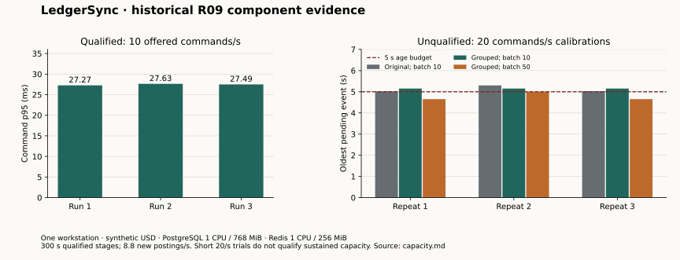

# Case study: an understandable financial result

## Problem

A transfer can commit while its response is lost. Its event can be delayed. A cache can be old. A useful operator console must explain these states without turning uncertainty into a second financial command or an invented zero balance.

LedgerSync uses one financial PostgreSQL database and small application modules. It keeps exact integer minor units, immutable posted history, stored command outcomes, and explicit account versions. Redis helps delivery and observations. It can be rebuilt from authoritative evidence.

## Decisions and costs

| Decision | Benefit | Cost and limit |
|---|---|---|
| One authoritative financial database | One atomic financial commit | Database locks and availability remain central concerns |
| Controlled functions and restricted workload roles | The API cannot directly edit protected financial tables | Migrations and privilege tests require careful ownership |
| Tenant and actor context with forced row policies | Missing application filters fail closed | A compromised shared trusted workload remains a stated trust limit |
| Durable full-intent retry | A lost response can resolve the original command | Clients must retain original key, body, credential binding, and request reference |
| Transactional outbox with fenced leases | Delivery can recover after process failure | Duplicate delivery is possible; receivers must deduplicate |
| Optional study features | Architecture experiments remain inspectable | Only the named feature sets are qualified |

The [architecture](architecture.md) shows these boundaries. The [phase register](progress.md) separates implemented work from later gates.

## Measured performance

The historical R09 component study qualified three 300-second stages at ten offered commands per second. Each stage created 2,640 new posted transfers. It also returned 300 replay responses and 60 new rejected outcomes. The rate of new postings was 8.8 per second. Command p95 was 27.27, 27.63, and 27.49 milliseconds. The recovery stage paused Redis and restarted the actual worker. All three runs reconciled to 3,168 total journals after all stages.

The [capacity report](capacity.md) supplies source manifests, resources, workload, and the unfavourable 20-command calibrations. Twenty offered commands per second did not qualify the queue-age budget. The chart is a historical Go component result on one workstation. It does not measure the browser, BFF, candidate HTTP throughput, a cloud provider, or a customer SLA. Later candidate checks keep their own identities.

## Defect and repair

The session store needs to look up an opaque session before it knows the tenant. Tenant-only filtering cannot protect that lookup. During R13, migration 000063 added exact-digest session policies and tenant-plus-actor preference policies. Rotation has separate old and replacement digest context. Cleanup is a bounded controlled operation and cannot delete another actor's session.

The [session storage regression](../../tests/integration/session_storage_boundary_test.go) uses restricted database roles. It checks missing and wrong digest context, actor boundaries, bounded cleanup, and poisoned pooled context. The [migration](../../migrations/000063_session_storage_boundaries.up.sql) shows the repair. Earlier failed and successful raw bundles remain private. [Public review metadata](../release-evidence/portfolio/r13/secret-review-resume.json) records related qualification identity without publishing raw private data.

The separate branch consolidation found a restore gap: database dumps contain policies but do not create cluster role identities. The [restore helper](../../scripts/local-backup-common.ps1) now creates a fixed set of inert policy roles before restore. It rejects privileged, login-enabled, or inherited identities. It does not restore credentials. This lesson belongs in every later recovery rehearsal.

## What the evidence permits

The project demonstrates exact local financial behavior, selected failure recovery, restricted-role checks, a bounded independent model, and explicit measurement limits. It does not establish bank settlement, regulatory approval, managed failover, a multi-host SLA, or independent accessibility acceptance. Read the [limitations](limitations.md) and the exact phase completion record before quoting a result.

## Statement and obligation extensions

CSV comparison and internal reservations have separate authority. Statement review records evidence; it cannot create a journal. A reservation changes available funds without changing posted ledger. Only capture creates one balanced transfer journal. Release and expiry preserve posted history.

The implementation uses narrow application modules, controlled database functions, forced tenant policies, fixed command intents and bounded exports. The actual-role suite checks denials, stale versions and races. The restore rehearsal compares all 76 retained table fingerprints, original CSV bytes, prepared comparison state, active holds, command replay and fenced expiry leases. The [R15](progress.md#r15-completion--17-october-2026), [R16](progress.md#r16-completion--17-october-2026) and [R17](progress.md#r17-completion--17-october-2026) records keep exact identities and limits. They do not relabel the historical R09 chart.

The final browser candidate also checks dependency loss: API readiness becomes unavailable while liveness remains available, then readiness recovers. Worker health waits for all five queues. These checks demonstrate selected local failures; they do not establish managed availability.
